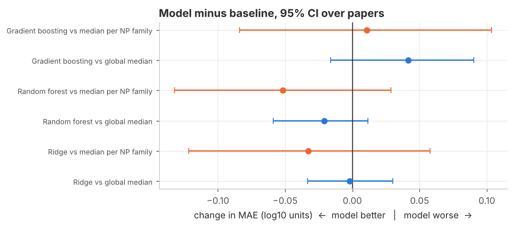
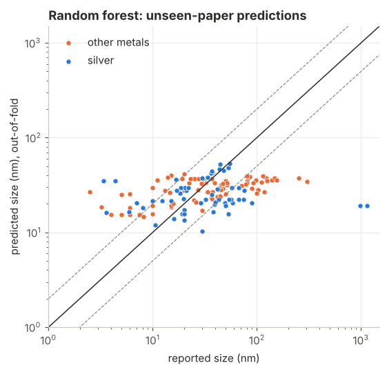
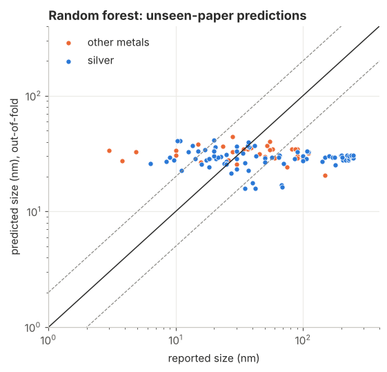
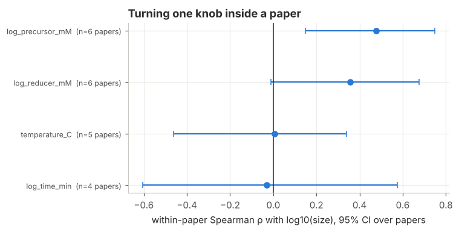

# Machine Learning for Nanoparticle Synthesis: Predicting Size and Shape from Literature-Mined Recipes

#### Mitacs Globalink Research Internship, University of Guelph (Summer 2024)

I built a dataset of nanoparticle synthesis experiments by extracting data from about 130 published papers, then trained models to predict nanoparticle **size** (regression) and **shape** (classification) from the synthesis recipe, for **chemical** and **green** (plant, fungal or bacterial extract) routes.

My first results looked strong (R² = 0.85 for size). When I re-evaluated the work, holding out whole papers instead of random rows, **no model could be reliably distinguished from a trivial baseline.** This repository contains both analyses and explains why they differ. The main contribution of the project is that lesson about evaluation and data, with the evidence for it.

---

## 1. At a glance

| | |
|---|---|
| **Question** | Can a synthesis recipe (reagents, concentrations, temperature, time, stirring) predict the size and shape of the nanoparticles, for a paper the model has never seen? |
| **Data** | 307 experiment rows extracted by hand from about 130 papers (46 chemical-synthesis, 84–85 green-synthesis; 2014–2024) |
| **Targets** | Average size (nm), as `log10(size)`. Shape, as spherical vs non-spherical. |
| **Methods** | Chemistry-informed features, paper-grouped nested cross-validation, baselines, paired bootstrap over papers, permutation importance, within-paper effect analysis |
| **Stack** | Python, pandas, scikit-learn, scipy, seaborn/matplotlib |
| **My role** | Literature search, data extraction and curation, cleaning, modelling, and the critical re-evaluation |
| **Supervisor** | Dr. Ashutosh Singh, University of Guelph (Mitacs Globalink Research Internship, May–Aug 2024) |
| **Certificate** | [Mitacs Globalink completion certificate](docs/Mitacs_Globalink_Completion_Certificate.pdf) |

### Findings in brief

1. **Held-out-paper performance is no better than baselines.** For chemical-synthesis size, the best model is typically off by a factor of 2.05, against 2.15 for predicting the global median (95% CI of the difference over papers: −0.059 to +0.012 log10 units, which includes zero). For green synthesis the model and the baseline are identical (2.50 vs 2.50).
2. **Most of the variation is between papers, not between recipes.** The share of variance in log-size explained purely by which paper a row comes from is 57% (chemical) and 79% (green).
3. **My initial numbers were inflated by a leaky evaluation.** A random row split put rows from the same paper in both training and test sets. The reported R² of 0.85 does not survive a paper-level split.
4. **One real effect remains.** *Within* a paper, raising the precursor concentration tends to raise particle size (Spearman ρ = 0.48, 95% CI 0.15 to 0.75; 6 papers, 61 rows).

---

## 2. Motivation

According to the International Union of Pure and Applied Chemistry (IUPAC), a nanoparticle is defined as a particle having one or more distinctive dimensions between ~1 and 100 nm. Nanoparticles represent a promising and innovative approach to material science and engineering. Nanoparticle properties such as plasmon resonance, catalytic activity and antibacterial effect depend strongly on size and shape. Those depend in turn on many interacting synthesis parameters: reagent identity and concentration, temperature, stirring, reaction time, and order of addition. Finding the most effective recipe and reaction conditions is time-consuming, labour-intensive, resource-intensive and is mostly trial and error, so a model that predicts outcomes from a recipe could narrow the search before anyone enters the lab.

The main obstacle is **data**. There is no standard, machine-readable repository of synthesis recipes. The information sits in the methods sections of papers, reported with inconsistent units and inconsistent completeness. Building a usable dataset from that literature was a large part of this work, and it turned out to determine what the models could learn.

---

## 3. Data

Both datasets cover papers on **antibacterial nanoparticles** found in a literature search (May–June 2024).

**Inclusion:** English, original research on nanoparticle synthesis, published 2014–2024.
**Exclusion:** reviews, case reports, papers that report results only in figures.

| | Chemical synthesis | Green synthesis |
|---|---|---|
| File | `data/Nanoparticles_Synthesis_Dataset - Chemical_Synthesis.xlsx` | `data/Nanoparticles_Synthesis_Dataset - Green_Synthesis.xlsx` |
| Raw size | 166 rows × 26 columns | 141 rows × 21 columns |
| Source papers | 46 titles (47 reference IDs) | 84 titles |
| Rows with a usable size | 147 (39 papers) | 120 (69 papers) |
| Rows with a reported shape | 103 (34 papers), 37% non-spherical | 121 (70 papers), 7% non-spherical (9 rows, 7 papers) |
| Rows per paper | median 2, max 18 | median 1, max 27 |


Each row carries the article title and a `Reference` ID, so every data point can be traced to its source. Columns with more than about 50–70% missing values (feeding rate, pressure, calcination, pH, stirring rate, coating, yield, min/max size and others) were not used.

---

## 4. Method (re-evaluation)

Two notebooks, one per synthesis route, share the helper module `src/np_utils.py`.

| Step | What is done | Why |
|---|---|---|
| **Cleaning** | Repair text encoding. Parse messy cells (ranges such as `5-30`, ratios stored as clock times by Excel). Merge label variants (`AgNps`, `AgNPs`, `Ag NPs` → Ag). | Mixed spellings and formats silently create fake categories. |
| **Targets** | `log10(size)`. Shape reduced to spherical vs non-spherical. **Rows with a missing target are dropped, never imputed.** | Raw sizes reach 1,140 nm. Most shape labels have 1–6 examples. An imputed target is a number the model was handed. |
| **Units** | Molar concentrations converted to mM. Mass or percent units (18% of precursor, 20% of reducing-agent, over half of stabiliser values) cannot be converted and are set to missing, with a "was missing" flag. | The 2024 version stored `0.005 mM` and `0.005 M` in one column. |
| **Features** | Nanoparticle family, reducing-agent class (borohydride, citrate, ascorbic acid, ...), stabiliser class, agitation class, log concentrations, reducer-to-precursor molar ratio, log time, temperature; for green synthesis also extract kind, genus and extract volume fraction. | Encodes what a chemist reasons about instead of arbitrary integer codes. |
| **Splitting** | Repeated (5×) 5-fold CV **grouped by paper**. Hyperparameters tuned in a nested loop that also groups by paper. Imputation, scaling and encoding fit inside each training fold. | Every score is on papers unseen in training, with no leakage from preprocessing. |
| **Baselines** | Global median; median per nanoparticle family (classification: class prior; prior per family). | A model only matters if it beats these. |
| **Models** | Ridge, Random Forest, Gradient Boosting (size). Logistic regression, Random Forest (shape). | Linear to non-linear, small tuned grids. |
| **Metrics** | Size: MAE in log10 units, reported as a fold error (`10^MAE`), R² in log space, share within a factor of 2. Shape: ROC-AUC, PR-AUC, Brier score, balanced accuracy. Plain accuracy is not used. | Always answering "spherical" is already 63–93% accurate. |
| **Uncertainty** | Paired bootstrap that resamples **papers**, for the difference between each model and each baseline. | Rows from one paper are not independent. |
| **Interpretation** | Permutation importance on held-out papers, feature-group ablation, ICC (share of variance explained by paper identity), within-paper effect analysis. | Impurity-based importances favour high-cardinality categories such as extract names. |

---

## 5. Results

### Size (typical fold error, lower is better; 5× repeated paper-grouped 5-fold CV)

| Model | Chemical (147 rows, 39 papers) | Green (120 rows, 69 papers) |
|---|---|---|
| Baseline: global median | 2.15× | 2.50× |
| Baseline: median per nanoparticle family | 2.31× | 2.66× |
| Ridge | 2.14× | 2.62× |
| Random Forest | **2.05×** | **2.50×** |
| Gradient Boosting | 2.38× | 2.78× |

A fold error of 2.05× means predictions are typically off by a factor of about two. For Random Forest versus the global median on chemical synthesis, the paired bootstrap gives a difference of −0.021 log10 units (95% CI −0.059 to 0.012): the data cannot tell them apart. No model has an interval that excludes zero against either baseline, in either dataset.



Predictions on unseen papers collapse into a narrow band regardless of the true size:

| Chemical | Green |
|---|---|
|  |  |

### Shape (spherical vs non-spherical)

| | Chemical (37% non-spherical) | Green (7% non-spherical) |
|---|---|---|
| ROC-AUC, class prior (chance) | 0.50 | 0.50 |
| ROC-AUC, prior per nanoparticle family | 0.66 | 0.51 |
| ROC-AUC, Random Forest | 0.67 | 0.29 |
| Brier score, Random Forest (class prior) | 0.213 (0.254) | 0.097 (0.069) |

For chemical synthesis, models match the "use the family's non-spherical rate" baseline; the signal sits at the nanoparticle-family level. For green synthesis there are only 9 non-spherical rows from 7 papers, so a held-out-paper evaluation cannot be estimated. The AUC below 0.5 is noise from too few positive papers, not a finding.

### Which inputs matter

* **Ablation (chemical).** Nanoparticle family alone gives a mean absolute error of 0.322 log10 units. Adding reagent classes (0.318), numeric recipe variables (0.321) or measurement method (0.321) changes nothing measurable.
* **Permutation importance (chemical).** The measurement method (SEM, TEM, DLS...) ranks first (0.027 ± 0.030), though with a wide interval. Part of what looks like chemistry is how sizes were measured.
* **Within-paper effects.** Subtracting each paper's own mean from the feature and the size removes lab, instrument and reporting differences. What remains:

| Feature (chemical) | Within-paper Spearman ρ | 95% CI | Papers |
|---|---|---|---|
| log precursor concentration | **0.48** | 0.15 to 0.75 | 6 |
| log reducing-agent concentration | 0.36 | −0.01 to 0.68 | 6 |
| temperature | 0.01 | −0.46 to 0.34 | 5 |
| log reaction time | −0.03 | −0.61 to 0.58 | 4 |

For green synthesis this analysis can barely be run: only 11 of 69 papers report more than one size, and for temperature (5 papers) the interval spans −0.46 to 0.69.



---

## 6. How the initial results compare with the re-evaluation

| | Initial notebooks | Re-evaluation notebooks |
|---|---|---|
| Split | Single random 80/20 split of rows (test set 33 and 27 rows) | 5× repeated 5-fold CV grouped by paper |
| Preprocessing | Imputed on the full data before splitting; **target values also imputed** (19 chemical and 12 green sizes; 61 chemical and 11 green shapes, all set to "Spherical") | Targets never imputed; imputation inside CV folds |
| Reported size result (chemical) | Gradient Boosting R² = 0.85, Random Forest 0.64 (raw nm) | No model distinguishable from the median baseline; R² in log space 0.03 (Random Forest), −0.26 (Gradient Boosting) |
| Reported shape result | 91% (chemical) and 96% (green) accuracy | ROC-AUC 0.67 vs 0.66 for the family baseline (chemical); not estimable (green) |
| Baselines | None | Global and per-family |

The numbers are not directly comparable (raw versus log scale, different metrics), but the conclusion is: the initial advantage was produced by the evaluation design. The SVM in the initial analysis scored exactly the majority-class baseline (78.8% and 92.6%), and the Random Forest's edge on green shape was one test row.

`scripts/robustness_check.py` reproduces the effect on the initial preprocessing. Holding out whole papers there drops the chemical-synthesis Random Forest R² far below zero, with very large swings between folds.

---

## 7. Key findings and takeaways

### Scientific

1. **The recipe-to-size relationship, as reported in this literature, does not generalise across papers.** With 39 chemical and 69 green papers, no model beats a median baseline on a paper it has not seen.
2. **Between-paper variation dominates** (ICC 0.57 and 0.79). Lab practice, instrumentation, how a "size" is defined and measured, and incomplete reporting overwhelm the recipe signal. Green synthesis is worse because the reducing agent is a biological extract of unknown composition, and the extract name is the main (and least describable) variable.
3. **There is a modest association inside papers.** When the same lab raises the precursor concentration, size tends to increase. Effects of this kind, where one paper changes one knob, are what literature data can actually identify, and they are invisible if rows are treated as independent. It is an observed association from six papers, not a proven causal effect.
4. **Measurement method is a confounder.** SEM, TEM, DLS and XRD report different quantities (dry core size versus hydrodynamic diameter versus crystallite size). A model that predicts "size" without conditioning on how it was measured predicts a blend of definitions.
5. **Shape is mostly a family-level property** in this data. Silver and gold are overwhelmingly spherical, and non-spherical examples are too few and too clustered in a handful of papers to learn anything beyond that.

### Methodological

1. **Split by the unit that creates dependence.** Rows from one paper share a lab, a method and a measurement. A random split lets a model recognise the paper instead of learning the chemistry. Grouped cross-validation is the minimum.
2. **Report baselines and uncertainty.** An R² of 0.85 means little without knowing what a median predictor scores, and a single 33-row test set varies enormously with the split. Paired bootstrap over papers makes "is this better than nothing?" a testable statement.
3. **Never impute the target, and never impute before splitting.** Both inflated my initial numbers.
4. **Do not use accuracy on imbalanced classes**, and prefer permutation importance on held-out data over impurity importances for high-cardinality features.
5. **A negative result is a result.** Showing *why* a model cannot generalise (ICC, within-paper effects, ablation) is more useful than a flattering score.

### What it taught me about data and responsibility

The project showed me how easily a dataset assembled from many human sources hides the structure that matters. Differences between sources are information about the data-generating process, not noise to average away, and a standard evaluation can conceal who or what a model fails on. I now see the same pattern in data built from many annotators: collapsing their disagreement into one label, and testing on random rows, hides which voices a model has not learned.

---

## 8. Limitations

* **Small data.** 39 and 69 papers, mostly with 1–3 rows each. Intervals are wide, and the ICC and within-paper estimates rest on few papers and should be read as indicative.
* **Hand-written feature rules.** Reducing-agent and stabiliser classes, nanoparticle families and extract kinds come from keyword rules I wrote. Extract genus is the first word of a free-text name, a weak proxy.
* **Unit assumptions.** `mol` is read as mol/L and `Mm` as mM; mass and percent concentrations are left missing.
* **Shape collapsed to two classes.** "Ellipsoidal" counts as non-spherical, and a finer morphology classification is not attempted.
* **Extraction errors are unmeasured.** Data were entered by hand from papers. I have not estimated the error rate, for example through a second extractor.
* **Search scope.** Papers on antibacterial nanoparticles only, found in a two-month search; this is not a systematic review.
* **Small tuning grids and five CV repeats.** Enough to compare against baselines, not to rank close models.
* **Two extreme sizes (about 1,000 nm, both silver) remain in the chemical data**; the log transform damps their influence.

---

## 9. Future directions

### Next steps for this project

1. **Hierarchical (mixed-effects or Bayesian) models** with a random effect per paper, so the lab-level offset is separated from the recipe effect and predictions come with honest uncertainty. A paper-level offset is exactly what the ICC says is missing.
2. **Data built to identify knob effects.** Papers that vary one factor at a time, or designed experiments, are the rows that carry causal information. A small number of controlled experiments, or active learning that chooses which recipe to run next, would add more than more scraped rows.
3. **Condition on measurement method and define the target.** Model size jointly with the characterisation technique, or restrict to one technique, so "size" means one thing.
4. **Describe the extract numerically.** Use plant species and part, extraction solvent and measured phenolic or total-reducing capacity instead of a name, to make green synthesis modellable.
5. **Add the missing variables.** pH, which is key in green synthesis, is not in the green sheet and is about 65% missing in the chemical sheet; stirring rate, precursor feeding rate and calcination also had too many gaps to use.
6. **Uncertainty-aware recommendation.** Once predictions are calibrated (for example with conformal prediction), invert the problem to recommend recipes for a target size, with the model able to say "I do not know" for unfamiliar chemistry.
7. **Measure extraction quality.** Double-extract a sample of papers to estimate the error rate of the dataset itself.

### Directions beyond this project

1. **Language-model-assisted data extraction.** The bottleneck was reading papers by hand. Extraction with language models and human verification, with measured agreement between extractors, could scale the dataset, and turns data-quality questions (disagreement between extractors, ambiguous reporting) into an NLP problem.
2. **A benchmark with held-out sources.** A public dataset and leaderboard where models are scored on unseen papers, with a datasheet that documents provenance, units and known gaps.
3. **Modelling source-level disagreement.** The methodological lesson, that variation between sources is structure to model and not noise to discard, applies directly to data labelled by many annotators. It motivates evaluating NLP models on held-out annotators and treating annotator disagreement as a representation problem, which is the direction of my doctoral application.

---

## 10. Repository layout

```
.
├── README.md
├── requirements.txt
├── data/
│   ├── Nanoparticles_Synthesis_Dataset - Chemical_Synthesis.xlsx
│   └── Nanoparticles_Synthesis_Dataset - Green_Synthesis.xlsx
├── notebooks/
│   ├── Chemical_Synthesis_v2.ipynb     # re-evaluation (executed, outputs included)
│   ├── Green_Synthesis_v2.ipynb        # re-evaluation (executed, outputs included)
│   └── archive_initial/                # initial notebooks (random split), kept for comparison
├── src/
│   └── np_utils.py                     # parsing, grouped CV, bootstrap, permutation importance
├── scripts/
│   └── robustness_check.py             # shows the leakage effect on the initial pipeline
├── docs/
│   └── Mitacs_Globalink_Completion_Certificate.pdf
└── figures/
    ├── chemical/
    └── green/
```

## 11. Reproducing

```bash
git clone <this-repo-url> && cd <repo>
python -m venv .venv && source .venv/bin/activate     # Windows: .venv\Scripts\activate
pip install -r requirements.txt                        # needs scikit-learn >= 1.6

jupyter notebook notebooks/                            # each notebook takes about 8 minutes on 2 cores

python scripts/robustness_check.py "data/Nanoparticles_Synthesis_Dataset - Chemical_Synthesis.xlsx" chem
python scripts/robustness_check.py "data/Nanoparticles_Synthesis_Dataset - Green_Synthesis.xlsx" green
```

The initial manuscript and notebooks used Python 3.9 and scikit-learn 0.24.2; the re-evaluation notebooks need scikit-learn 1.6 or newer (they use `GroupKFold(shuffle=True)`).

## 12. Data sources and licence

Each row's `Title of Article` and `Reference` ID identify the paper it came from. The values are experimental parameters reported in those papers. Please cite the original authors if you reuse specific entries. The code is released under the MIT licence (see `LICENSE`). The dataset is a compilation of values reported in published papers, so it is shared for research and reproduction; please cite the original papers when you reuse specific entries.

## 13. Contact

**Kunal Mishra**, IIT Roorkee (Chemical Engineering) · [LinkedIn](https://www.linkedin.com/in/kunal-mishra-0b117a228/) · [Portfolio](https://kunal-mishra.vercel.app/)
